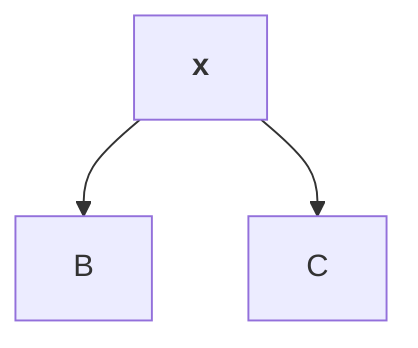

# Title Here

| a | b |
|---|---|
| 1 | 2 |

- [x] done
- [ ] todo

~~gone~~ and https://example.com autolink.

Footnote ref[^1].

[^1]: The note.

```go
func main() { fmt.Println("hi") }
```



```
plain block
```
